# 聊天记录工坊 · Chatlog Studio

> 项目名：`mock_chatui`

一个纯本地运行的 QQ / 微信聊天记录编排小工具：像聊天一样直接发消息，也可以逐段编辑 OneBot 12 消息段，最后导出成一张 PNG。

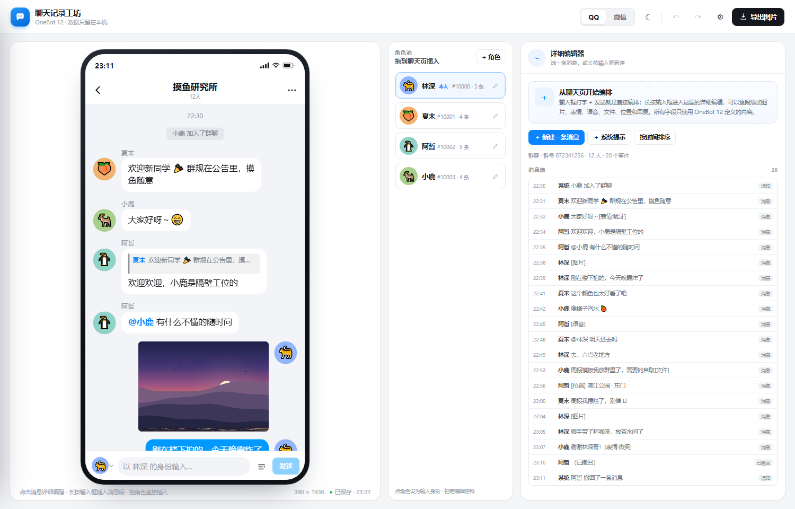

## 三个页面

主页面是一个空壳工作台，两个功能页面分开写、共用一套 CSS / JS：

| 页面 | 作用 |
| --- | --- |
| [`index.html`](index.html) | 工作台空壳：两个入口卡片 + 本地记录概览 |
| [`chat.html`](chat.html) | 聊天页：全屏（手机）或居中的手机壳（桌面），直接打字编排 |
| [`editor.html`](editor.html) | 编辑页：左侧聊天页展示，右侧角色池 + 详细编辑器并排 |

两个子页面共用 [`css/app.css`](css/app.css) 与 [`js/i18n.js`](js/i18n.js)、[`js/core.js`](js/core.js)、[`js/render.js`](js/render.js)、[`js/ui.js`](js/ui.js)。数据存在同一个 `localStorage`，所以从聊天页切到编辑页、再回工作台，记录都在。

## 多语言（中文 / English）

界面支持中文与英文切换，不依赖任何第三方库，也不联网。

| 切换入口 | 位置 |
| --- | --- |
| 工作台 `index.html` | 顶栏右侧「中文 / English」按钮 |
| 聊天页 / 编辑页 | 打开设置侧栏 → 外观 → 语言 |

- 语言选择保存在 `localStorage` 的 `mock_chatui:lang`，刷新、跳转页面后保持。
- 首次打开时：已有保存值优先；否则按 `navigator.language` 判断，`zh*` 用中文，其余用英文。
- 切换后立即更新：静态 HTML 文案、动态渲染的抽屉 / 角色池 / 详细编辑器 / 导出弹窗 / 确认框 / toast、页面 `document.title` 与 `<html lang>`，以及 **Canvas 预览与导出的 PNG**（标题栏成员数 / 在线、时间分隔、通知句、空状态、图片不可用等系统文案）。
- 翻译边界：**只翻译界面系统文案**。聊天标题、角色昵称、消息正文、文件名、示例聊天内容（如“摸鱼研究所”“夏末”“欢迎新同学”）以及 OneBot 事件字段与数据结构都保持原样，不做翻译或改写。
- QQ 表情名称：英文界面使用 `js/core.js` 中 `CM.FACE_EN` 的英文名，中文界面保留 QQ 原名（如“呲牙” ↔ `Grin`）。
- 实现方式：`js/i18n.js` 提供 `CM.i18n.tr('中文', 'English', vars)`，静态 HTML 用成对的 `data-zh` / `data-en`（及 `data-zh-title`、`data-zh-placeholder`、`data-zh-aria` 等属性）标注；动态模板在渲染时调用 `tr()`，语言变化后重新渲染。

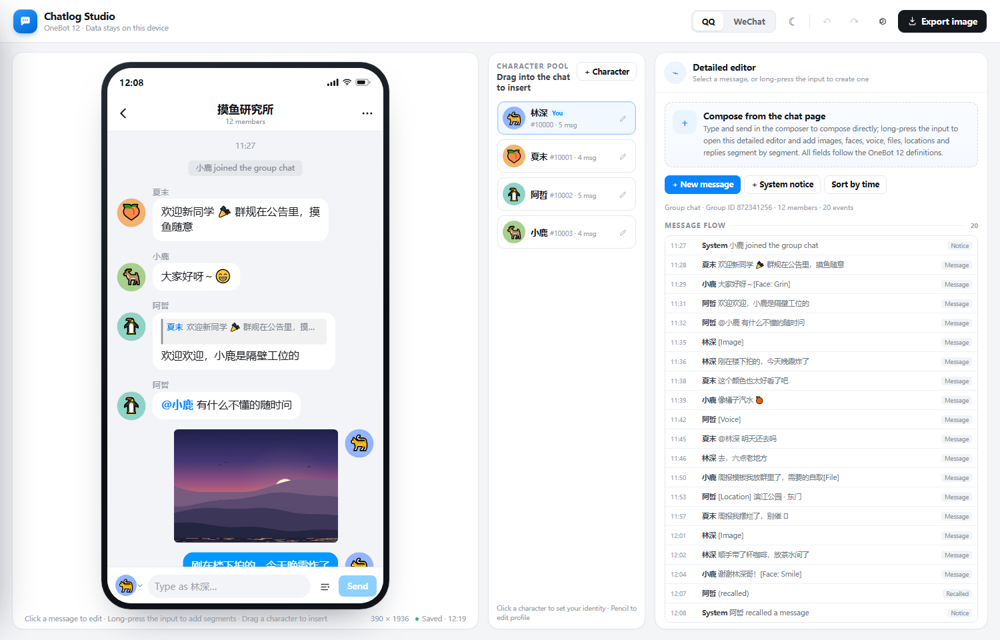

| English shell | English mobile |
| --- | --- |
| 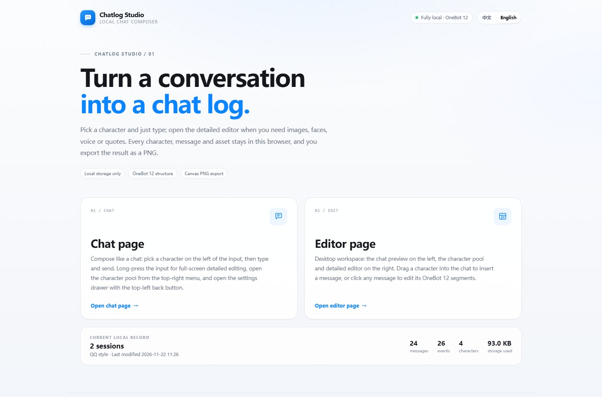 | 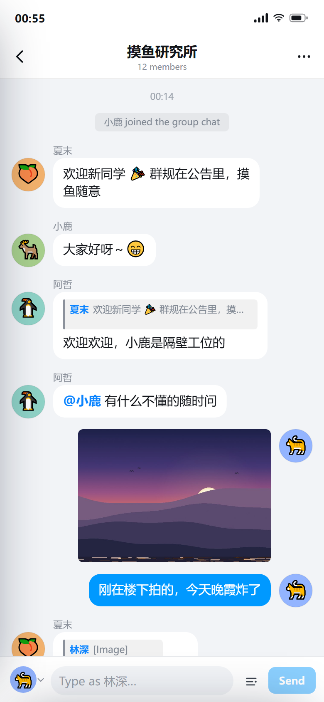 |

## 快速开始

直接双击 [`index.html`](index.html) 打开即可，不需要安装依赖，也不需要联网。

- 浏览器建议 Edge / Chrome。
- 聊天页与编辑页通过同一个 `file://` 源共享本地数据；在 Edge 实测可跨页面读写。
- 如果某个浏览器对 `file://` 的 localStorage 有限制，可以在目录里跑一个静态服务器：

```bash
python -m http.server 8080
# 然后打开 http://127.0.0.1:8080/index.html
```

> 首次打开任一子页面会自动生成一份示例聊天记录（“摸鱼研究所”群聊 + 与“夏末”的私聊）。之后所有修改自动保存。

## 怎么用

### 聊天页（像聊天一样直接编排）

- **输入框左侧是角色选择**：点击头像切换“以谁的身份发言”。
- 输入文字，回车或点「发送」，消息就追加到聊天里；默认直接使用纯文本，不需要理解消息段。
- **长按输入框**（或点输入框右边的详细编辑图标）会创建一条新消息并打开详细编辑：可以逐段添加图片、QQ 表情、@、语音、文件、位置、回复。
- 点击聊天里的任意消息，也会打开它的详细编辑。
- **右上角菜单**打开角色池；点角色可设为当前输入身份。
- **左上角返回键 / 点击标题 / 顶栏齿轮**打开设置侧栏：聊天名、群号、类型、背景色 / 背景图、是否显示昵称、字体大小、气泡宽度、时间间隔、状态栏时间、导出宽度，以及数据备份。
- 设置侧栏顶部有「页面」导航：聊天页 / 编辑页 / 工作台。

### 编辑页（桌面工作台）

- 左侧是同一套聊天页渲染，右侧是**角色池**与**详细编辑器**。
- 把角色卡片从角色池拖到左侧聊天页，会在落点插入一条该角色的消息；拖动时会出现蓝色插入线。
- 点击聊天里的消息（或右侧「消息流」里的行）打开详细编辑器。
- 角色池卡片：点击设为输入身份，拖动直接插入消息，铅笔按钮编辑昵称 / 头像 / 底色。
- 详细编辑器只提供 OneBot 12 定义的消息段与事件字段，可查看当前事件的完整 JSON。
- 角色池、详细编辑器在窄屏会自动变成底部抽屉 / 全屏浮层；桌面宽屏下并排。

### 详细编辑（两端一致）

每个消息段都是 OneBot 12 的消息段：

| 消息段 | 事件中的字段 | 渲染 |
| --- | --- | --- |
| `text` | `data.text` | 普通文本，支持换行 |
| `mention` | `data.user_id` | @昵称 |
| `mention_all` | 无 | @全体成员 |
| `image` | `data.file_id` | 图片，本地压缩后存入文件表 |
| `voice` | `data.file_id` | 语音条 + 本地时长 |
| `audio` / `video` | `data.file_id` | 媒体卡片 |
| `file` | `data.file_id` | 文件卡片 + 本地文件名/大小 |
| `location` | `latitude` / `longitude` / `title` / `content` | 位置卡片 |
| `reply` | `message_id` / `user_id` | 引用块 |
| `qq.face` | `data.id` | QQ 表情（OneBot 扩展规则允许的扩展消息段） |

图片、语音、文件本身的数据与名称/大小/时长保存在**本地文件表** `files` 中，事件里只保留 `file_id`。事件中没有昵称、头像、聊天名等展示字段，这些都从 `characters` / `sessions` 按 `user_id` 解析。

## 右键 / 长按菜单

消息、消息流和角色卡片都支持上下文菜单：

- **消息 / 消息流**：桌面右键，触屏长按约 520ms，可详细编辑、复制文本、复制消息、上移 / 下移、删除。
- **角色卡片**：右键 / 长按，可设为发送身份、插入一条消息、编辑角色、删除角色。
- 桌面菜单跟随指针；手机端是底部动作面板；点菜单外部、按 Esc 或执行动作都会关闭。
- 输入框保留原生长按详细编辑；桌面右键输入框使用系统文本菜单，触屏则不会弹出系统菜单。

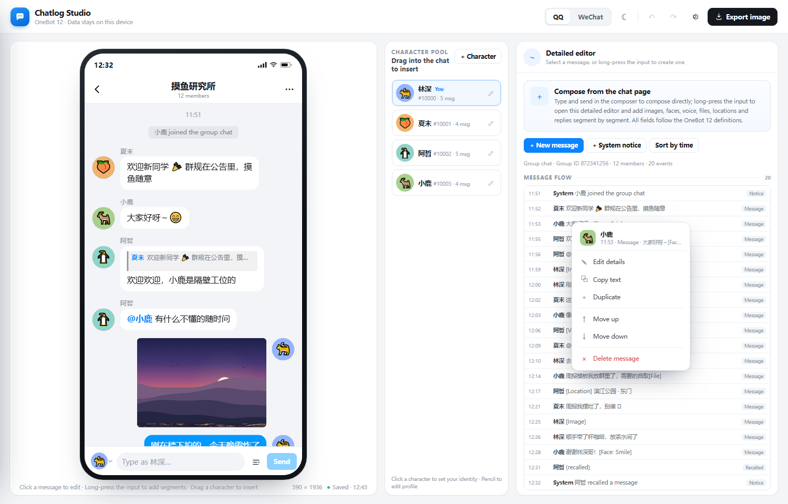

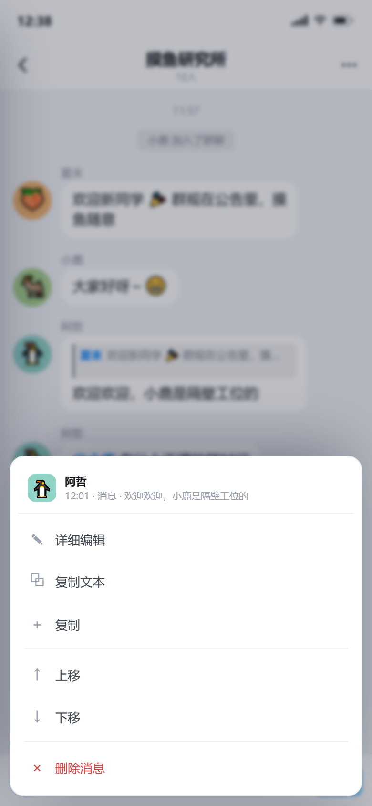

## OneBot 12 数据结构

数据集外层是本工具自己的封套，里面的消息事件按 [OneBot 12](https://12.onebot.dev/) 的结构保存：

```json
{
  "format": "mock_chatui/onebot12",
  "version": 1,
  "self": { "platform": "qq", "user_id": "10000" },
  "characters": [
    { "user_id": "10000", "name": "林深", "avatar": "🐈", "color": "#93b4ff" }
  ],
  "files": {
    "f_xxx": {
      "name": "photo.webp",
      "mime": "image/webp",
      "size": 12345,
      "dataUrl": "data:image/webp;base64,..."
    }
  },
  "sessions": [
    {
      "id": "sess_demo_group",
      "title": "摸鱼研究所",
      "detail_type": "group",
      "group_id": "872341256",
      "member_count": 12,
      "events": [
        {
          "id": "evt_xxx",
          "time": 1790000000,
          "type": "message",
          "detail_type": "group",
          "sub_type": "",
          "self": { "platform": "qq", "user_id": "10000" },
          "message_id": "1001",
          "message": [{ "type": "text", "data": { "text": "你好" } }],
          "alt_message": "你好",
          "user_id": "10001",
          "group_id": "872341256"
        }
      ]
    }
  ],
  "settings": { "platform": "qq", "mode": "light", "fontSize": 15 }
}
```

- 事件基础字段：`id`、`time`（Unix 秒）、`type`、`detail_type`、`sub_type`、`self`。
- 消息事件：`message_id`、`message`（消息段数组）、`alt_message`、`user_id`，群聊额外有 `group_id`。
- 系统提示使用标准群通知事件：`group_member_increase`、`group_member_decrease`、`group_message_delete`，字段为 `group_id`、`user_id`、`operator_id`，撤回/删除事件额外有 `message_id`。
- 所有消息段只使用 OneBot 12 定义的类型；唯一的扩展段是 `qq.face`，命名符合 OneBot 扩展规则的 `<prefix>.` 前缀。
- 聊天名、群号、成员数只属于外层会话展示信息，不写入事件。
- `alt_message` 在提交时由消息段重新计算。

## 本地存储与备份

- 数据键：`mock_chatui:dataset:v1`（UI 状态另存 `mock_chatui:ui:v1`，语言另存 `mock_chatui:lang`）。
- 兼容旧项目名：如果本机还留着 `chatlog-mock:*` 的数据，启动时会一次性迁移到 `mock_chatui:*`；旧键保留用于回滚。
- 默认配额约 5 MB；上传图片会先压缩成 WebP（图片最大边 1280px，头像 240px，背景 1600px），再写入 `files`。
- 设置侧栏 → 数据：
  - 导出 JSON（包含角色、会话、事件、素材）
  - 导入 JSON
  - 查看已用空间、素材数、事件数
  - 数据校验（OneBot 基础字段、消息段参数、文件引用）
  - 清理未引用素材 / 恢复示例 / 清空全部
  - 撤销 / 重做
- 换浏览器、换设备或清理站点数据前，先导出 JSON 备份。

## 导出图片

- 顶栏「导出图片」或设置侧栏 → 数据 →「导出图片」。
- 可选 720 / 1080 / 1440 px 宽；可选包含顶部标题栏 / 状态栏。
- 用 Canvas 重新绘制，不是截屏；所以导出宽度的文字是重新光栅化的，清晰度高于屏幕截图。
- 输出 PNG，可直接下载；部分浏览器如果拦截下载，可右键导出预览图另存。
- 导出图不包含输入框、角色池、侧栏等编辑 UI。

<a href="screenshots/export-final.png">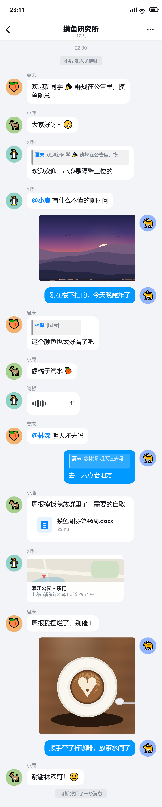</a>

## 目录结构

```text
mock_chatui/
├─ index.html               # 工作台空壳
├─ chat.html                # 聊天页
├─ editor.html              # 编辑页
├─ css/
│  ├─ app.css               # 聊天页 / 编辑页 / 抽屉 / 消息段编辑器
│  └─ shell.css             # 工作台
├─ js/
│  ├─ demo-assets.js        # 内置示例图片（base64，无网络）
│  ├─ i18n.js               # 中 / 英双语运行时（无依赖）
│  ├─ core.js               # 数据模型、OneBot 辅助、校验、localStorage
│  ├─ render.js             # Canvas 聊天页渲染 / 导出
│  └─ ui.js                 # 两个子页共用的交互
├─ dist/                    # 单文件构建产物（CSS/JS 全部内联）
├─ screenshots/             # 验收截图
└─ tools/
   ├─ gen-assets.py         # 生成示例图片（开发用）
   ├─ build-single.mjs      # 构建 dist/
   └─ shot.mjs              # 可选：本地 headless 截图脚本（开发用）
```

### 单文件构建

```bash
node tools/build-single.mjs
```

会生成 `dist/chat.html`、`dist/editor.html`、`dist/index.html`，CSS / JS 全部内联，适合放进沙箱 iframe、发给别人或离线打开。源文件仍是分文件的版本。构建产物同样包含 `js/i18n.js`，单文件版也可以切换中 / 英文，语言偏好仍写入同一个 `mock_chatui:lang`。

## 实现说明

- 聊天页渲染与导出共用 [`js/render.js`](js/render.js) 的 Canvas 渲染器，预览与导出的差异只有宽度、是否包含标题栏/状态栏。
- 输入框的直接编排走纯文本；详细编辑才创建消息段，属于“高级模式”，不会强迫用户先理解 `data.file_id`。
- 详细编辑只暴露 OneBot 12 允许的字段；不会提供任意 JSON 编辑器或自定义事件类型。
- `json-block` 可以展开当前事件的完整 OneBot JSON，方便核对。
- 所有素材都在本地：没有请求 CDN、字体、图床或 OneBot 实现；运行时不需要网络。

## 已知限制

- 这是聊天记录**编排工具**，不是在运行的 OneBot 实现，也不连接真实 QQ / 微信。
- localStorage 容量有限；大量高清图片会更快达到配额，图片会压缩，但建议及时清理未引用素材。
- 单张导出图受浏览器 Canvas 高度限制（超长聊天会报错，而不是自动分页）。
- `qq.face` 是 QQ 平台扩展消息段，其他 OneBot 实现不一定支持；本工具只在本地渲染。
- 数据不会自动同步到其他浏览器 / 设备，请用 JSON 备份迁移。

## 验收截图

| 编辑页 | 聊天页（手机） |
| --- | --- |
|  | 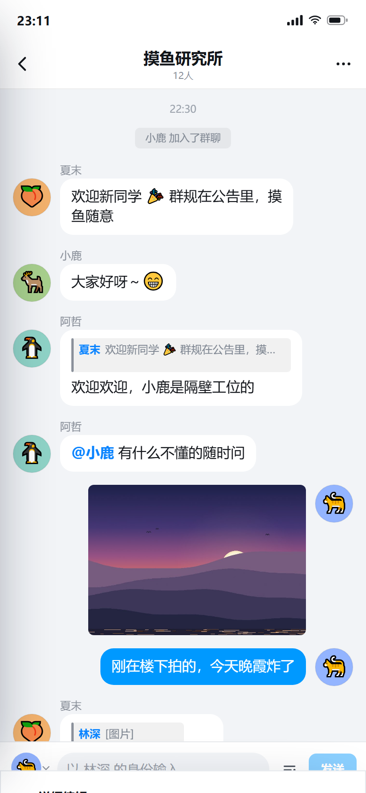 |

| 手机角色池 | 手机详细编辑 |
| --- | --- |
| 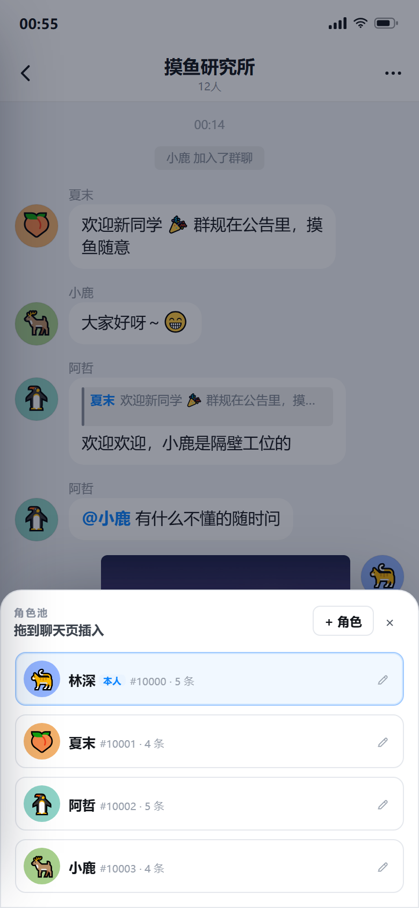 | 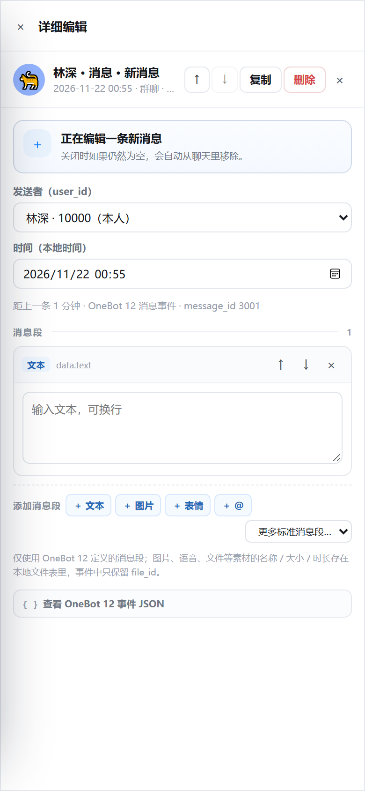 |

| 角色池（桌面） | 详细编辑（桌面） |
| --- | --- |
| 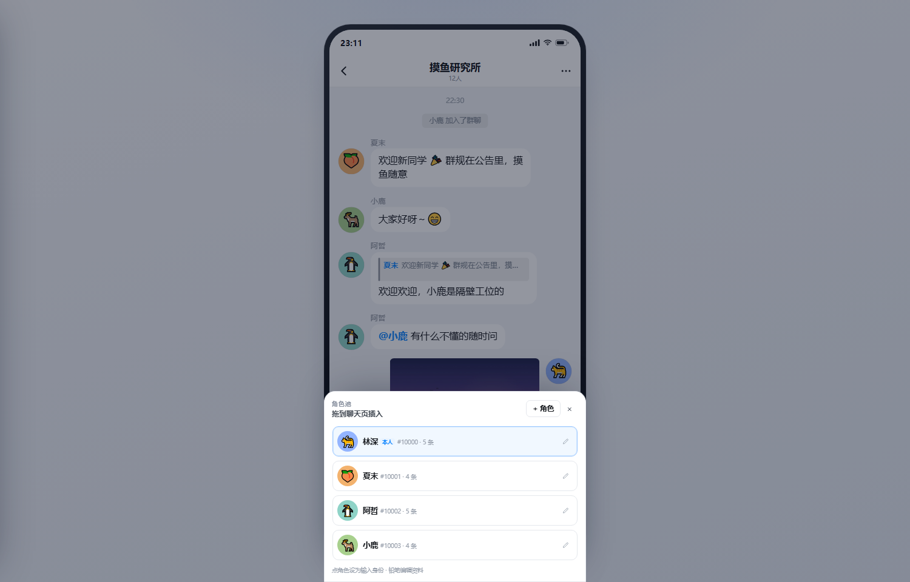 | 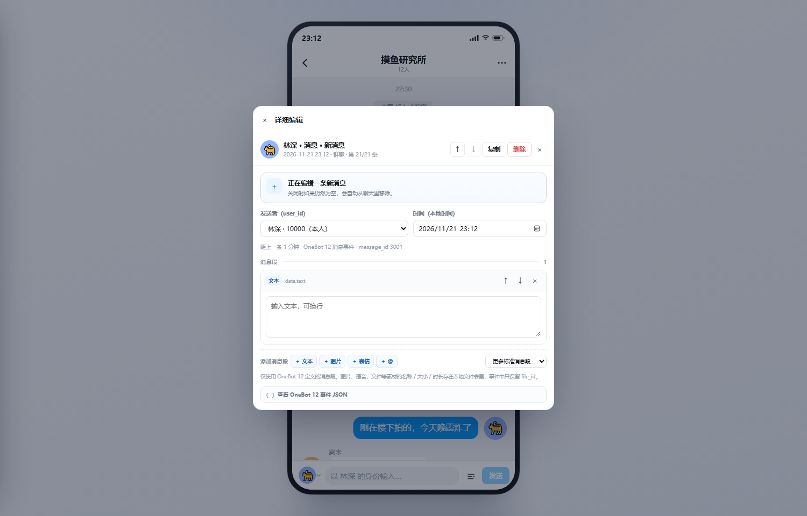 |

| 微信深色 | 工作台 |
| --- | --- |
| 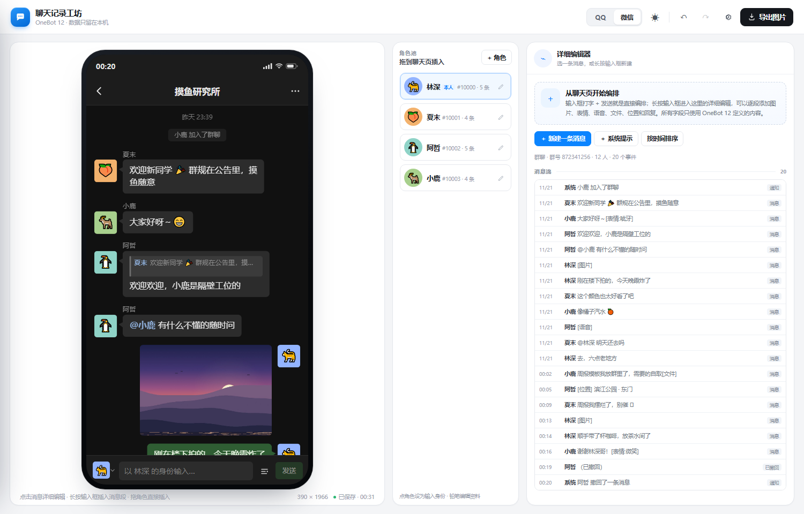 | 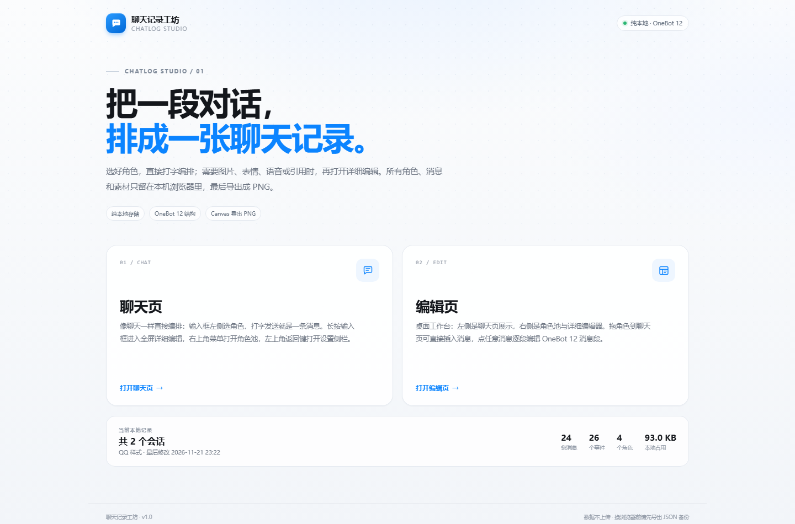 |
